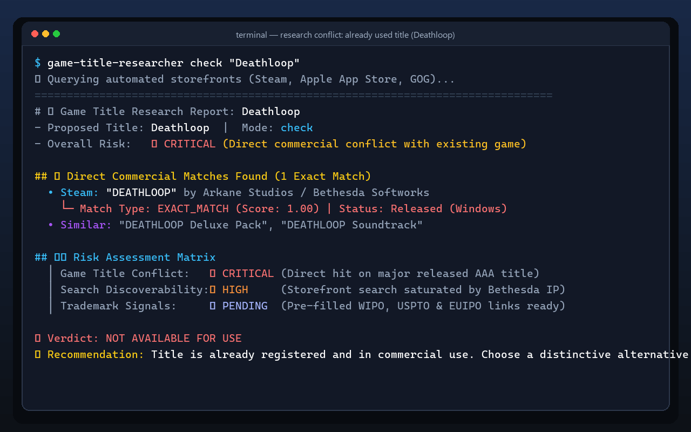
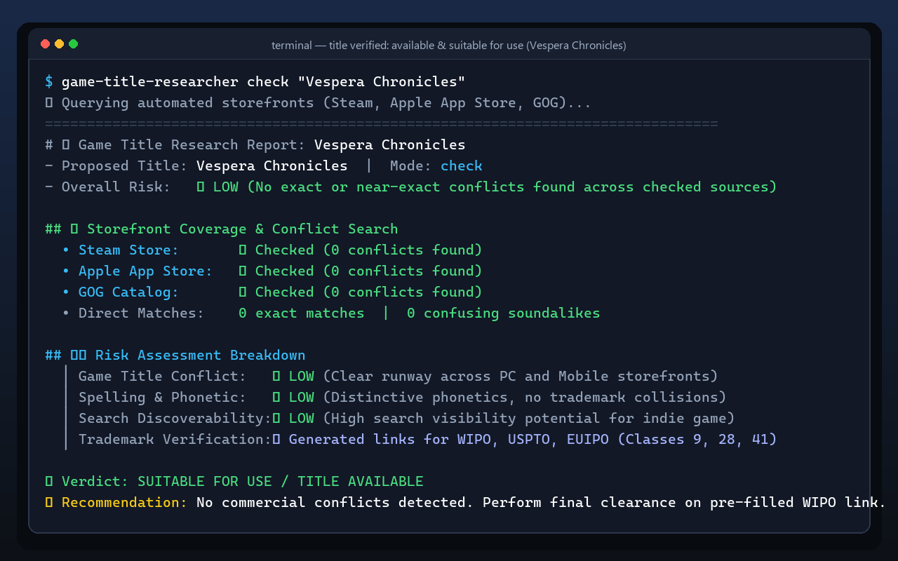

<div align="center">


# 🎮 Game Title Researcher

### The Open Title Intelligence & Conflict Detection Radar for Game Developers

[](https://www.python.org/)
[](https://opensource.org/licenses/MIT)
[](https://agentskills.io)
[](https://github.com/mahmutbaysag/game-title-researcher)

<p align="center">
  <b>Don't announce a game title only to discover an existing Steam hit or trademark conflict 6 months later.</b><br>
  Instant storefront availability checks, phonetic similarity analysis, trademark portal deep-links, and multi-dimensional risk scores — <b>zero API keys, zero configuration required</b>.
</p>

[Quick Preview](#-quick-preview) •
[Screenshots](#-terminal-screenshots) •
[Why This Tool?](#-why-game-title-researcher) •
[Features](#-features) •
[Installation & AI Agents](#-installation--ai-agent-setup) •
[CLI Usage](#-cli-usage) •
[Contributors](#-contributors)

</div>

---

### ⚡ Quick Preview

```bash
$ python -m scripts check "Ironhold"

[1/4] 🔍 Querying automated storefronts (Steam, Apple App Store, GOG)...
[2/4] 🧬 Running phonetic (Metaphone) & similarity metrics (Levenshtein, Token Sort)...
[3/4] 🏛️  Generating Nice Classes (9, 28, 41, 42) trademark verification links...
[4/4] ⚖️  Synthesizing 7-dimension risk profile...

================================================================================
🎯 TITLE RESEARCH REPORT: Ironhold
================================================================================
🚨 Overall Risk Level: CRITICAL (Direct commercial conflict)
📌 Direct Storefront Matches:
   - "Ironhold" by PixelForge (Steam, 2021) [EXACT_MATCH]
⚠️  Phonetic & Structural Matches:
   - "Iron Hold: Tactics" (App Store, 2023) [TOKEN_SORT: 92% | SOUNDEX: MATCH]
💡 Generated Alternatives: Iron Citadel, Iron Haven, Forgehold, Anvil Guard
================================================================================
```

---

## 📸 Terminal Screenshots

<p align="center">
  <b>1. Taken Title / Commercial Conflict Detected (🔴 CRITICAL Risk)</b><br>
  <em>Example: Researching "Deathloop" detects an active Steam release and flags a direct conflict.</em><br><br>
  
</p>

<p align="center">
  <b>2. Available Title / Suitable for Use (🟢 LOW Risk)</b><br>
  <em>Example: Researching "Vespera Chronicles" confirms zero storefront collisions and greenlights the name.</em><br><br>
  
</p>

---

## 💡 Why Game Title Researcher?

| Pain Point | How Game Title Researcher Solves It |
| :--- | :--- |
| **API Gatekeeping** | **100% Keyless by Default.** Automated queries across Steam, App Store, and GOG without accounts, tokens, or cards. |
| **Hidden Conflicts** | **Phonetic & Fuzzy Matching Engine.** Catches typo variants, transposed words, and phonetic soundalikes (*Nightfall* vs *Knightfall*). |
| **Legal Blindspots** | **Instant Trademark Deep Links.** Auto-generates pre-filtered query URLs for WIPO, USPTO, EUIPO, TMview, and TÜRKPATENT. |
| **Agent Ecosystem** | **Universal Agent Skills Standard.** Drop into **Claude Code, Cursor, Antigravity, Roo Code, Codex** or run as standalone CLI. |

---

## 🚀 Features

- **Keyless Automated Research:** Queries Steam, Apple App Store, and GOG out of the box without registration or credentials.
- **Intelligent Title Matching:** Combines exact normalized matching, Levenshtein distance, Jaro-Winkler, Token Set/Sort ratios, and Soundex/Metaphone phonetic algorithms.
- **Generic Word Filtering:** Filters 50+ common game tropes ("War", "Legend", "Dark", "Dead", etc.) to minimize false positives.
- **Trademark Link Generator:** Produces pre-filled query links for WIPO Global Brand Database and direct portals for USPTO, EUIPO, TMview, and TÜRKPATENT (Nice Classes 9, 28, 41, 42).
- **Storefront Manual Checklists:** Generates deep search links for PlayStation, Xbox, Nintendo eShop, itch.io, Epic Games Store, and Google Play.
- **Multi-Dimensional Risk Matrix:** Evaluates 7 distinct risk dimensions and computes clear preliminary ratings (`LOW`, `MODERATE`, `HIGH`, `CRITICAL`, `INSUFFICIENT_DATA`).
- **Markdown & JSON Output:** Generates clean Markdown reports and machine-readable JSON for CI/CD or agent pipelines.

---

## 📦 Installation & AI Agent Setup

### 🤖 Using with AI Agents (Claude Code, Cursor, Codex, Antigravity, Roo Code, OpenCode)

This skill follows the open [Agent Skills Specification](https://agentskills.io/specification). AI agents discover and execute it automatically.

#### 1. Claude Code
Clone directly into Claude Code's skill directory:
```bash
# Global installation (available across all projects)
git clone https://github.com/mahmutbaysag/game-title-researcher.git ~/.claude/skills/game-title-researcher

# Or project-level installation
git clone https://github.com/mahmutbaysag/game-title-researcher.git .claude/skills/game-title-researcher
```

#### 2. Antigravity (Google)
Clone into Antigravity user or project skills folder:
```bash
# Windows
git clone https://github.com/mahmutbaysag/game-title-researcher.git "%USERPROFILE%\.gemini\antigravity-cli\skills\game-title-researcher"
```

#### 3. Cursor, Codex CLI, OpenCode, Goose, Roo Code
Clone into your project's `.skills/` directory:
```bash
git clone https://github.com/mahmutbaysag/game-title-researcher.git .skills/game-title-researcher
```
Any compatible agent will parse `SKILL.md` metadata, dynamically activate it when you ask to check a game title, and run research workflows.

---

### 💻 Standalone CLI Usage (Without AI Agent)

```bash
git clone https://github.com/mahmutbaysag/game-title-researcher.git
cd game-title-researcher

# Create and activate virtual environment
python -m venv .venv
# Windows:
.venv\Scripts\activate
# Linux/macOS:
source .venv/bin/activate

# Install package and dependencies
pip install -e .
```

Or install directly via git without cloning:
```bash
pip install git+https://github.com/mahmutbaysag/game-title-researcher.git
```

---

## 💻 CLI Usage

Once installed, use either the `game-title-researcher` command or `python -m scripts`:

### Check a Single Title
```bash
game-title-researcher check "Ironhold"
# or: python -m scripts check "Ironhold"
```

Verbose progress tracking:
```bash
game-title-researcher check "Ironhold" -v
```

Machine-readable JSON output:
```bash
game-title-researcher check "Ironhold" --json
```

### Compare Two Titles
```bash
game-title-researcher compare "Ironhold" "Iron Hold"
```

---

## ⚖️ Legal Disclaimer

This tool performs preliminary factual research and is **not legal advice**. Trademark and intellectual property rights depend on jurisdiction, goods and services classification, prior commercial use, and legal precedent. Always consult a qualified trademark attorney before commercial release or major financial investment.

---

## 👥 Contributors

- **Mahmut Baysağ** ([@mahmutbaysag](https://github.com/mahmutbaysag)) - Project Creator & Lead Developer
- **Antigravity** (Google DeepMind) - AI Pair Programmer & Co-developer

---

## 🤝 Community & Contributing

- **Contributing:** See [CONTRIBUTING.md](CONTRIBUTING.md) for local dev setup and PR guidelines.
- **Changelog:** See [CHANGELOG.md](CHANGELOG.md) for release notes.
- **Security Policy:** See [SECURITY.md](SECURITY.md) for vulnerability disclosure.

---

## 📄 License

MIT License. See LICENSE file for details.
